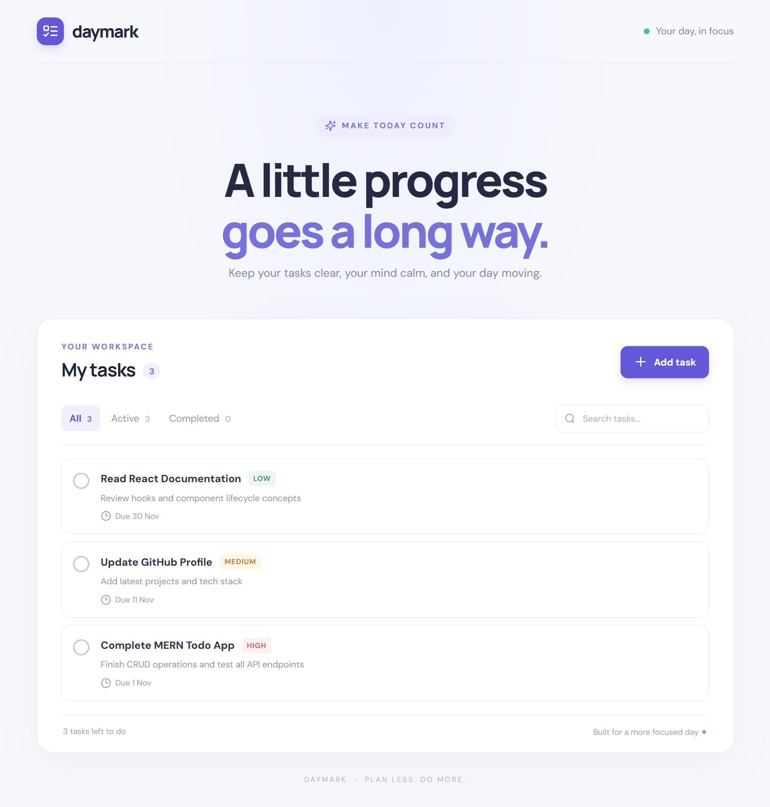

# Daymark – MERN Todo App

<p align="center">
  
  
  
  
  
  
</p>

A modern, responsive Todo application built using the **MERN Stack (MongoDB, Express.js, React.js, and Node.js)**. Daymark helps users organize their daily tasks, track progress, set priorities, and manage deadlines through a clean and intuitive interface.

## 📸 Screenshots

<p align="center">
  
</p>

## ✨ Features

- **Create Tasks:** Add new tasks with titles and descriptions.
- **Edit Tasks:** Update existing task details.
- **Delete Tasks:** Remove tasks when they are no longer needed.
- **Task Completion:** Mark tasks as completed or active.
- **Task Filtering:** Filter tasks by All, Active, and Completed.
- **Search Tasks:** Search tasks by title or description.
- **Priority Management:** Assign Low, Medium, or High priority.
- **Due Dates:** Set deadlines for individual tasks.
- **Responsive Design:** Works across desktop, tablet, and mobile devices.
- **REST API:** Backend API for managing todo operations.

## 🛠️ Tech Stack

**Frontend**
- React.js
- JavaScript
- HTML5
- CSS3
- Vite
- Lucide React

**Backend**
- Node.js
- Express.js
- REST API

**Database**
- MongoDB
- Mongoose

## 📂 Project Structure

```text
mern-todo-app/
│
├── client/
│   ├── public/
│   ├── src/
│   │   ├── App.jsx
│   │   ├── main.jsx
│   │   └── styles.css
│   ├── index.html
│   ├── package.json
│   └── vite.config.js
│
├── server/
│   ├── src/
│   │   ├── models/
│   │   │   └── Todo.js
│   │   ├── routes/
│   │   │   └── todoRoutes.js
│   │   └── server.js
│   ├── package.json
│   └── .env.example
│
├── .gitignore
└── README.md
```

## ⚙️ Installation & Setup

### Prerequisites

Make sure you have installed:

- [Node.js](https://nodejs.org/)
- [MongoDB](https://www.mongodb.com/) or a MongoDB Atlas account
- [Git](https://git-scm.com/)

### 1. Clone the Repository

```bash
git clone https://github.com/your-username/mern-todo-app.git
cd mern-todo-app
```

### 2. Backend Setup

Navigate to the server directory:

```bash
cd server
npm install
```

Create a `.env` file using `.env.example`:

```env
PORT=5000
MONGO_URI=mongodb://127.0.0.1:27017/mern_todo_app
CLIENT_URL=http://localhost:5173
```

Start the backend server:

```bash
npm run dev
```

The backend will run at:

```text
http://localhost:5000
```

### 3. Frontend Setup

Open another terminal and navigate to the client directory:

```bash
cd client
npm install
```

Start the React development server:

```bash
npm run dev
```

Open the application in your browser:

```text
http://localhost:5173
```

## 🔗 API Endpoints

| Method | Endpoint | Description |
|---|---|---|
| GET | `/api/todos` | Get all todos |
| GET | `/api/todos/:id` | Get a specific todo |
| POST | `/api/todos` | Create a new todo |
| PATCH | `/api/todos/:id` | Update a todo |
| PATCH | `/api/todos/:id/toggle` | Toggle task completion |
| DELETE | `/api/todos/:id` | Delete a todo |
| GET | `/api/health` | Check API status |

### Example Todo Request

```json
{
  "title": "Complete MERN project",
  "description": "Finish building the Todo application",
  "priority": "high",
  "dueDate": "2026-11-05"
}
```

## 🚀 Future Improvements

- User authentication and authorization using JWT
- Individual task management for each user
- Dark mode
- Task sorting and advanced filtering
- Dashboard with task statistics
- Deployment with MongoDB Atlas

## 👨‍💻 Author

**Ajinkya Dhatrak**

GitHub: [@ajinkya029](https://github.com/ajinkya029)

---

⭐ If you like this project, consider giving it a star!